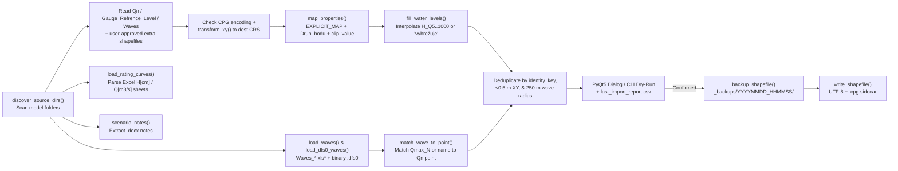

# Hydro Doplnenie — QGIS Automation Plugin & CLI (`v0.3.0`)

**Hydro Doplnenie** (`QGIS >= 3.34`) automates the bulk ingestion of Slovak hydrological model deliverables (`Qn`, `Gauge_Refrence_Level`, `Waves`, Excel rating curves, and MIKE Zero `.dfs0` flood waves) into the master `Hydrologia_SK_doplnenie.shp` shapefile.

Instead of manually zooming to each point in QGIS, digitizing a feature on screen, copying 10+ attributes, and looking up water levels in Excel row-by-row, specialists scan entire model folders, inspect every proposed record and computed rating-curve level in a preview dialog, and apply only the selected records after an automatic timestamped backup.

---

## Processing Pipeline



---

## Project Layout

```text
QGIS-plugin-automation/
  hydro_automation/
    hydro_doplnenie/          # QGIS >= 3.34 plugin package
      __init__.py             # classFactory() QGIS entrypoint
      plugin.py               # Toolbar icon & menu registration ("Hydro Doplnenie")
      dialog.py               # Interactive PyQt5 preview table, filters & layer picker
      engine.py               # Shared discovery, mapping, interpolation, dfs0 & I/O engine
      metadata.txt            # QGIS plugin manifest (v0.3.0)
    dist/
      hydro_doplnenie-0.3.0.zip
    build_plugin.py           # Packages hydro_doplnenie-<version>.zip into dist/
    import_to_doplnenie.py    # Standalone CLI runner (--apply / dry-run)
    last_import_report.csv    # Audit CSV written on scan/import
    requirements.txt          # fiona>=1.9, pandas>=2.0, openpyxl>=3.1, xlrd>=2.0
  SL_10-Hydrological_data/    # Sample hydrological model deliverables
  VH-70d-Hydrological_data/   # Sample model containing .dfs0 & .docx
  VH_31..VH_67-Hydrological_data/
```

*(Note: `QGIS-FILES/` (~8.3 GB containing base river topology `SUPPORTING-MATERIALS`, `VH_SR_DATASET`, and live `HYDROLOGY-ADDITION`) is excluded from Git via the root [`.gitignore`](../.gitignore).)*

---

## Technical Deep Dive (`hydro_doplnenie/engine.py`)

### 1. Source Layer Discovery & Unknown Shapefile Classification
- `discover_source_dirs(roots)` locates model folders containing `Qn.shp` or `Gauge_Refrence_Level.shp` (handling both direct `Hydrological_data/` paths and parent model folders).
- `find_unknown_shapefiles(roots)` flags `.shp` files outside `SOURCE_LAYERS = ("Qn", "Gauge_Refrence_Level", "Rating_Curves", "Waves")` (ignoring `_backups/`).
- `shapefile_summary(path)` inspects field names and guesses a role:
  - Fields containing `f0_vodoct` / `f0_vodoc` / `nula_vodoc` → `Gauge_Refrence_Level`
  - Fields containing `q10` + `q100` alongside `Waves_*.xls*` files → `Waves`
  - Otherwise → `Qn`
- In the QGIS UI (`dialog.py`), user decisions for non-standard shapefiles are persisted in `QgsSettings` (`hydro_doplnenie/unknown_shapefile_choices`).

### 2. Shapefile Encoding & Coordinate Transformation
- **CPG Sidecar Fix (`shapefile_encoding`):** Because QGIS sets `SHAPE_ENCODING=""` for GDAL inside its Python environment, Fiona can mis-decode Central European characters (e.g., `Varínka`). `engine.py` explicitly reads `.cpg` sidecar files and maps `1250` → `cp1250`, `utf-8`/`65001` → `utf-8`, and `iso-8859-2`/`88592` → `iso-8859-2`.
- **CRS Reprojection:** `same_crs()` compares EPSG codes / WKT against the destination layer; points in a different CRS are reprojected on the fly via `fiona.transform.transform` (default destination CRS when creating/writing is `EPSG:5514`).
- **Date Field Workaround:** `IGNORE_DATE_FIELDS = ("Geodesy_st",)` skips malformed legacy shapefile date fields when opening via Fiona.

### 3. Attribute Mapping & `Druh_bodu` Inference
`map_properties()` initializes every destination attribute, assigns `Druh_bodu` via `infer_druh()` (`"QH"` for gauges, `"vlna ..."` for waves, `"prietok"` for flow points), applies `EXPLICIT_MAP`, copies remaining matching column names (omitting `Qmax_*` for `QH` gauge rows), and truncates/casts values to exact shapefile schema widths via `clip_value()`:

| Source Field(s) | Destination Field | Notes |
|---|---|---|
| `Tok`, `tok` | `tok` | River / watercourse name |
| `Profil`, `profil` | `profil` | Station / profile name |
| `rkm`, `rkm_DHI` | `rkm_DHI` | River kilometer |
| `Plocha_pov`, `A_Povodia` | `A_Povodia` | Catchment area |
| `hydro_cisl`, `hydro_cislo`, `Hydrolog_C` | `Hydrolog_C` | Hydrological number |
| `tr_spolah`, `Presnost` | `Presnost` | Trailing period stripped (`.rstrip(".")`) |
| `F0_vodočt`, `F0_vodoc`, `nula_vodoc` | `nula_vodoc` | Gauge zero level (`Druh_bodu == "QH"` only) |
| Any matching column name | Same name | `Qmax_1`, `Qmax_2`, `Qmax_5`, `Qmax_10`, `Qmax_20`, `Qmax_50`, `Qmax_100`, `Qmax_1000`, etc. |

### 4. Excel Rating-Curve Interpolation (`H_Q*` & `"vybrežuje"`)
- `Rating_Curves.shp` shares coordinates with `Gauge_Refrence_Level.shp` and is reported as `skip_layer` so duplicate points are never created.
- Instead, `load_rating_curves()` parses all `.xlsx` / `.xls.xlsx` sheets (`parse_curve_sheet`), locating the header row containing `h abs` / `h` and `q` and building sorted `(Q, H_cm)` tables keyed by sheet name (matched against `EXCEL_ID` / `ID_Zmluva`).
- `fill_water_levels()` interpolates each `Qmax_*` (`QMAX_TO_H`: `Qmax_5`→`H_Q5`, `Qmax_10`→`H_Q10`, `Qmax_20`→`H_Q20`, `Qmax_50`→`H_Q50`, `Qmax_100`→`H_Q100`, `Qmax_1000`→`H_Q1000`):
  - If `q > q_max + 1e-6`, writes `"vybrežuje"` (overbank flow).
  - If `q <= q_min`, clamps to minimum `H_cm`.
  - Otherwise linearly interpolates `h0 + (h1 - h0) * (q - q0) / (q1 - q0)` and formats integers cleanly when within `0.05` (`format_h`).

### 5. Flood Waves (`Waves_*.xls*` & Binary MIKE Zero `.dfs0`)
- **Excel Wave Tables (`load_waves` / `parse_wave_sheet`):** Extracts `Typ vlny` (`Q10`, `Q100`, ...), `Qmax`, and `ID zmluva`, merges referenced wave periods (`Q10`, `Q100`, etc.) into `Druh_bodu = "vlna Q10 Q100 ..."`, and fills `Qmax_<period>`.
- **Binary `.dfs0` Parser (`read_dfs0` & `load_dfs0_waves`):** Decodes DHI `DHI_DFS_` binary files directly using Python `struct` (matching `DFS_ITEM_NAME_TAG = b"\xff\xfe\x35\x75"`, `DFS_DATA_START = b"\xff\xfe\x50\xc3"`, and float32/float64 records `DFS_RECORD = b"\xfe\x51\xc3\xff"`) without needing `mikeio`.
- **Smart Matching (`match_wave_to_point`):** Links `.dfs0` peaks to `Qn` points in the same folder by matching `Qmax_<period>` within `max(1.0, 1% of peak)` or ASCII-folded river/profile token overlap (`fold_ascii`), reporting unmatched waves clearly as `unmatched`.

### 6. Deduplication, Backups & Audit Report
- **Three-Tier Deduplication (`emit`):**
  1. Exact normalized `identity_key(tok, profil, rkm, druh, xy)` match (`xy` rounded to `0.1 m`).
  2. Same normalized `Druh_bodu` (folding typos like `prieotk` / `prietoky` → `prietok`) within `0.5 m` Euclidean distance.
  3. For waves (`is_wave=True`), an existing `vlna*` point on the same river (`tok`) within `WAVE_MATCH_RADIUS_M = 250.0` meters.
- **Backups:** `backup_shapefile()` copies all sidecar files (`<stem>.*`) to `<dest_dir>/_backups/<YYYYMMDD_HHMMSS>/` before writing.
- **Audit CSV:** `write_report()` exports `model, source_dir, layer, action, tok, profil, rkm, Druh_bodu, note` to `last_import_report.csv` (`utf-8-sig` for clean Excel UTF-8 opening).

---

## Usage

### Option A — QGIS Plugin (Recommended)
1. In QGIS (`3.34+`), open **Plugins → Manage and Install Plugins → Install from ZIP**.
2. Choose `hydro_automation/dist/hydro_doplnenie-0.3.0.zip` (rebuild anytime with `python hydro_automation/build_plugin.py`).
3. Click the **Hydro Doplnenie** toolbar action, pick the destination shapefile (or active QGIS vector layer) and source folders, click **Scan**, review/uncheck rows in the preview table, and click **Import selected**.

### Option B — Command Line Interface
```bash
cd QGIS-plugin-automation
pip install -r hydro_automation/requirements.txt

# 1. Dry-run (writes hydro_automation/last_import_report.csv without modifying shapefiles)
python hydro_automation/import_to_doplnenie.py

# 2. Custom source / destination / unknown shapefile role override
python hydro_automation/import_to_doplnenie.py ^
  --dest QGIS-FILES/HYDROLOGY-ADDITION/Hydrologia_SK_doplnenie.shp ^
  --source SL_10-Hydrological_data ^
  --use "path/to/CustomLayer.shp=Qn"

# 3. Apply changes (creates timestamped backup in _backups/ first; close layer in QGIS first)
python hydro_automation/import_to_doplnenie.py --apply
```
