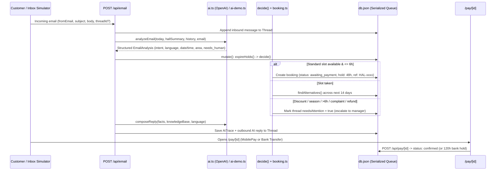

# HallBook — Sports Hall Booking & Email Assistant (`SportsHall-booking-system`)

**HallBook** puts a live booking calendar, automated email assistant, and online reservation hold workflow behind a sports hall's existing email address (`booking@sondervang-hal.dk`), designed for Danish school sports halls and local clubs moving off paper schedules and manual email back-and-forth.

The system handles routine bookings, availability checks, and facility Q&A automatically while escalating anything requiring human judgment (discounts, season agreements, >6-hour events, refunds, complaints) directly to the hall manager (**Lars Mikkelsen**).

---

## Architecture & Email Processing Pipeline



---

## Core Modules & Data Model

### 1. Persistence Layer ([`src/lib/db.ts`](./src/lib/db.ts) & [`src/lib/seed.ts`](./src/lib/seed.ts))
- **File Store:** Stored as formatted JSON at `data/db.json` (git-ignored) and initialized via `createSeedDb()` on first access.
- **Concurrency Control:** Every read (`readDb`) and write (`mutate`) chains onto a single module-level `queue: Promise<unknown>` so concurrent HTTP requests never overwrite each other.
- **Atomic Writes:** Writes to `data/db.json.tmp` and swaps via `fs.rename`, with a Windows fallback that writes directly and removes `.tmp` if a local file lock blocks rename.
- **Pre-Seeded Week (`DEFAULT_HALL`):** `Søndervang Skole – Sports Hall` with three zones (`Full hall` @ `600 DKK/hr`, `Half A` @ `350 DKK/hr`, `Half B` @ `350 DKK/hr`), opening hours (`07:00–22:00` Mon–Fri, `08:00–20:00` Sat–Sun), weekday school PE blocks (`08:00–15:00`), recurring club sessions, and an editable `knowledgeBase`.

### 2. Schema ([`src/lib/types.ts`](./src/lib/types.ts))
- **`Booking`:** `id`, `ref` (`HAL-1001+`), `date` (`YYYY-MM-DD`), `start`/`end` (`HH:MM`), `area` (`"full" | "a" | "b"`), `status` (`"confirmed" | "awaiting_payment" | "blocked" | "cancelled" | "expired"`), `source` (`"manual" | "email" | "import" | "web"`), `amount`, `paymentStatus` (`"paid" | "unpaid" | "none"`), `paymentMethod` (`"mobilepay" | "bank" | "invoice" | null`), `holdExpiresAt`, `seriesId`, `threadId`.
- **`EmailAnalysis`:** `intent` (`booking_request`, `availability_question`, `info_question`, `cancellation`, `payment_question`, `other`), `language` (`da` / `en`), `date`, `start`, `end`, `area`, `purpose`, `participants`, `booking_reference`, `missing_info`, `needs_human`, `human_reason`, `summary`.
- **`AiTrace`:** Stored per inbound message for full auditability (`intent`, `summary`, `extracted`, `actions`, `escalated`, `escalationReason`).

### 3. Scheduling & Conflict Engine ([`src/lib/booking.ts`](./src/lib/booking.ts))
- **`areasOverlap(a, b)`:** Returns `true` if either booking uses `"full"` or `a === b` (`"a"` and `"b"` can run in parallel).
- **`ACTIVE_STATUSES`:** `["confirmed", "awaiting_payment", "blocked"]` block new reservations; `"cancelled"` and `"expired"` release the slot.
- **`expireHolds(db)`:** Automatically converts `awaiting_payment` bookings whose `holdExpiresAt < now` into `"expired"` before every availability check and state read.
- **`freeIntervals(db, date, area)`:** Computes available windows (`>= 30 min`) clipped to that weekday's `openingHours`.
- **`findAlternatives(db, req, max = 3)`:** Scans 30-minute increments over up to 14 days (returning same-day options immediately if found), ranking options by time distance `|start - wanted|` plus a `15`-minute penalty when switching halves (`a <-> b`).

### 4. Dual-Mode AI & Deterministic Bilingual Fallback ([`src/lib/ai.ts`](./src/lib/ai.ts) & [`src/lib/ai-demo.ts`](./src/lib/ai-demo.ts))
- **OpenAI Mode:** Active automatically when `OPENAI_API_KEY` starts with `sk-` and is not a placeholder/localhost override. Uses OpenAI Chat Completions (`gpt-4.1-mini` by default) with strict `json_schema` (`ANALYSIS_SCHEMA`) for extraction and natural-language generation grounded strictly in `decision.facts` + `knowledgeBase`.
- **Built-In Demo Mode (`demoAnalyzeEmail` / `demoComposeReply`):** Zero-dependency Danish + English parser supporting:
  - Date formats: ISO (`2026-11-21`), Danish (`14. november`), English (`14 november`), `DD/MM`, and relative weekdays (`lørdag`, `saturday`, etc.).
  - Time ranges: `kl. 14-16`, `14:00-16:00`, `from 14 to 16`, `14 til 16`.
  - Bilingual replies and targeted knowledge-base section extraction (`pickKb()`).
- **Automatic Manager Escalation Rules (`src/lib/email-agent.ts`):**
  - Keywords indicating discounts, season bookings, recurring weekdays, complaints, refunds, or negotiations (`needs_human = true`).
  - Bookings exceeding `hall.maxAutoBookingHours` (`6` hours).
  - Cancellations requested from an email address different from the booking owner.
  - Cancellations of already-paid bookings (auto-cancels the slot so it frees up, while flagging the refund for the manager).

---

## Routes & REST API Reference

### UI Routes (`src/app/`)
| Route | Description |
|---|---|
| `/` | Prototype overview and 5-minute client demo walkthrough |
| `/calendar` | Manager weekly/day calendar across Full Hall, Half A, and Half B with modal editing & recurring series support |
| `/inbox` | Simulated customer email inbox showing threads, `AiTrace` reasoning, manager escalation badges, and manual reply form |
| `/payments` | Payment ledger tracking unpaid holds, paid confirmations, bank-transfer references (`HAL-xxxx`), and expired holds |
| `/settings` | Editable hall profile, area pricing, opening hours, hold durations, bank details, and facility knowledge base |
| `/book` | Public customer self-service weekly availability & booking page |
| `/pay/[id]` | Customer payment link page with simulated instant MobilePay and 5-day Bank Transfer hold option |

### API Endpoints (`src/app/api/`)
| Endpoint | Methods | Purpose |
|---|---|---|
| `/api/state` | `GET` | Expires stale holds and returns full `Db` state + active AI provider metadata (`openai` vs `demo`) |
| `/api/reset` | `POST` | Resets `data/db.json` back to `createSeedDb()` |
| `/api/email` | `POST` | Processes an incoming customer email (`fromEmail`, `subject`, `body`, optional `threadId`), runs AI + booking rules, returns updated `Thread` |
| `/api/bookings` | `POST` | Creates manual single or recurring weekly bookings (up to 60 occurrences) with conflict & opening-hours checks |
| `/api/bookings/[id]` | `PATCH`, `DELETE` | Updates booking fields, marks bookings as paid (`markPaid: true` triggers confirmation email), or deletes single/series bookings (`?series=1`) |
| `/api/pay/[id]` | `GET`, `POST` | Retrieves public payment summary or processes simulated `"mobilepay"` / `"bank"` payment (`POST`) |
| `/api/public/week` | `GET` | Returns 1-hour available slots across all 3 areas for a given `?week=YYYY-MM-DD` |
| `/api/public/book` | `POST` | Creates a public `awaiting_payment` hold from `/book` and returns `/pay/[id]` |
| `/api/hall` | `PUT` | Persists changes to hall settings, pricing, opening hours, and knowledge base |
| `/api/threads/[id]` | `POST`, `PATCH` | Sends a manual manager reply (`POST`) or marks an escalated thread as handled (`PATCH`) |

---

## Running Locally

```bash
cd SportsHall-booking-system
npm.cmd install        # or npm install
npm.cmd run dev        # starts http://localhost:3000
```

### Optional Environment Variables (`.env.local`)
Copy [`.env.example`](./.env.example) to `.env.local`:
```env
OPENAI_API_KEY=sk-...
OPENAI_MODEL=gpt-4.1-mini
# OPENAI_BASE_URL=https://api.openai.com/v1
```
Without `OPENAI_API_KEY`, the built-in bilingual demo assistant runs automatically.
