# LEJAK Monorepo — Technical Architecture Reference

This document provides an end-to-end engineering reference across all four systems in the **LEJAK** monorepo:

1. [`WebSite/`](../WebSite/README.md) — Public agency homepage & generalized interactive demo subpage (`/projects`)
2. [`SportsHall-booking-system/`](../SportsHall-booking-system/README.md) — **HallBook**: AI-assisted email inbox, calendar, and payment-hold system
3. [`vesna-collector/`](../vesna-collector/README.md) — **VESNA Collector**: Decoupled worker + FastAPI monitoring dashboard for ~1,100 SHMÚ hydrological stations
4. [`QGIS-plugin-automation/`](../QGIS-plugin-automation/README.md) — **Hydro Doplnenie**: QGIS 3.34+ plugin & CLI engine for hydrological shapefile mapping, Excel rating-curve interpolation, and MIKE `.dfs0` wave matching

---

## 1. Cross-Cutting Engineering Principles

Every system in this repository shares three architectural invariants:

### 1.1 Human-in-the-Loop Escalation
Automation handles deterministic or repetitive work and routes edge cases to a human operator rather than silently guessing:
- **HallBook:** Discounts, full-season bookings, complaints, refunds, bookings longer than `maxAutoBookingHours` (`6h`), and cross-email cancellations set `needs_human = true` / `thread.needsAttention = true` so the hall manager (`Lars Mikkelsen`) handles them manually.
- **VESNA Collector:** Routine fetches are silent. Only runs that fail, hit `alert_failure_ratio >= 0.2`, or reach `failing_after = 3` consecutive station failures trigger SMTP alerts.
- **Hydro Doplnenie:** Specialists filter and inspect every mapped candidate point (`New`, `Already in layer`, `Wave not placed`, `Error`, `Scenario info`) in the PyQt5 preview table before any write occurs.

### 1.2 Crash-Safe Persistence & Idempotency
- **HallBook (`src/lib/db.ts`):** All reads/mutations serialize through a chained `Promise` queue (`mutate()` / `readDb()`) and write via atomic `.tmp` rename (with direct-write fallback when Windows file locks block `fs.rename`).
- **VESNA Collector (`collector/storage.py` & `collector/services.py`):** Measurements use `(station_id, observed_at, variable)` unique constraints with dialect-aware `ON CONFLICT DO NOTHING RETURNING id` (`_insert_ignore`), preventing duplicates across overlapping 24-hour SHMÚ windows. On worker startup (`Worker.run_forever`), `recover_interrupted_runs` marks any orphaned `RUNNING` rows as `FAILED`.
- **Hydro Doplnenie (`hydro_doplnenie/engine.py`):** `identity_key(tok, profil, rkm, druh, xy)` plus `< 0.5 m` coordinate proximity and `250.0 m` (`WAVE_MATCH_RADIUS_M`) wave-to-gauge checks prevent duplicate insertions; `backup_shapefile()` copies all shapefile sidecars into `_backups/<YYYYMMDD_HHMMSS>/` prior to calling `write_shapefile()`.

### 1.3 Zero-Config Offline & Demo Fallbacks
- **HallBook (`src/lib/ai.ts` & `src/lib/ai-demo.ts`):** Uses OpenAI Structured Outputs (`ANALYSIS_SCHEMA`) when a valid `OPENAI_API_KEY` (`sk-...`) is configured, and seamlessly falls back to a bilingual (Danish + English) regex/heuristic engine (`demoAnalyzeEmail`, `demoComposeReply`) when running without API credentials.
- **VESNA Collector (`collector/config.py`):** Defaults to local SQLite (`data/collector.db`) when `DATABASE_URL` is empty, and skips SMTP cleanly (`email_enabled == False`) when `SMTP_HOST` or `ALERT_TO` is unset.
- **Hydro Doplnenie (`hydro_doplnenie/engine.py`):** Includes a pure-Python binary parser (`read_dfs0`) for DHI MIKE Zero `.dfs0` files and an XML extractor (`read_docx_paragraphs`) for `.docx` boundary-condition notes—requiring zero proprietary DHI SDKs or external `python-docx` dependencies.

---

## 2. Monorepo Component Map

```mermaid
flowchart TB
    subgraph Web["WebSite (Next.js 15 · Vercel)"]
        Home["/ (Agency Homepage)"]
        Projects["/projects (Generalized Interactive Demos)"]
        Contact["ContactForm -> formsubmit.co"]
    end

    subgraph Hall["SportsHall-booking-system / HallBook (Next.js 16 · TS)"]
        MailAPI["POST /api/email"]
        BookingLib["booking.ts + email-agent.ts"]
        AI["ai.ts (OpenAI) / ai-demo.ts (Fallback)"]
        PayAPI["POST /api/pay/[id]"]
        JsonDB[("data/db.json (Serialized Queue)")]
        MailAPI --> AI --> BookingLib --> JsonDB
        PayAPI --> JsonDB
    end

    subgraph Vesna["vesna-collector (Python · FastAPI + Worker)"]
        Worker["Worker (APScheduler + Heartbeat)"]
        Engine["engine.py + http.py (Polite Async Fetcher)"]
        FastAPI["web/app.py (htmx + Chart.js UI)"]
        SQLDB[("SQLite / PostgreSQL")]
        SMTP["SMTP Alerting (notify.py)"]
        Worker --> Engine --> SQLDB
        Engine --> SMTP
        FastAPI <--> SQLDB
    end

    subgraph QGIS["QGIS-plugin-automation / Hydro Doplnenie (Python · PyQGIS)"]
        Dialog["dialog.py (PyQt5 Preview UI)"]
        CLI["import_to_doplnenie.py"]
        QEngine["engine.py (CRS · Curves · Waves · dfs0)"]
        Backup["_backups/ + Hydrologia_SK_doplnenie.shp"]
        Dialog --> QEngine
        CLI --> QEngine
        QEngine --> Backup
    end
```

---

## 3. System Deep Dives

### 3.1 `WebSite` — Agency Presence & Generalized Capabilities
- **Stack:** Next.js 15 (`App Router`), React 19, Vanilla CSS (`app/globals.css`), `@vercel/analytics/next`.
- **Routes:** `/` ([`app/page.jsx`](../WebSite/app/page.jsx)) and `/projects` ([`app/projects/page.jsx`](../WebSite/app/projects/page.jsx)).
- **Design Constraint:** All client-facing copy on `/` and `/projects` intentionally abstracts away internal project names, Slovak hydrological terms, and repository links, presenting general capabilities (*01 · Booking & Inbox*, *02 · Scheduled Data Collector*, *03 · Workflow & Data Mapper*) purely in English.
- **Full Documentation:** [`WebSite/README.md`](../WebSite/README.md).

---

### 3.2 `SportsHall-booking-system` — HallBook Booking & Email Agent
- **Stack:** Next.js 16 (`App Router`), React 19, TypeScript, Tailwind CSS v4.
- **Booking State Machine:**
  - `awaiting_payment` (48h hold via `holdHours`, extended to 120h via `bankTransferHoldHours` when bank transfer is chosen)
  - `confirmed` (instant via simulated MobilePay or manual admin payment)
  - `blocked` (school PE hours / administrative blocks)
  - `cancelled` / `expired` (automatically expired on read/mutate via `expireHolds(db)`)
- **Email Processing Pipeline (`processIncomingEmail`):**
  1. Appends incoming message to existing or newly created `Thread` in `data/db.json`.
  2. Runs `analyzeEmail` (OpenAI `json_schema` or `demoAnalyzeEmail`) to extract `intent`, `language` (`da`/`en`), `date`, `start`, `end`, `area` (`full`/`a`/`b`), `booking_reference` (`HAL-\d+`), and `needs_human`.
  3. Executes deterministic `decide()` inside `mutate()`:
     - Enforces `maxAutoBookingHours` (`6h`), `withinOpeningHours()`, and `findConflicts()` (`areasOverlap` treats `full` as overlapping both `a` and `b`).
     - Computes `findAlternatives()` over the next 14 days in 30-minute increments if conflicted.
     - Creates `awaiting_payment` hold + `/pay/[id]` link, or cancels/flags paid refunds, or answers via `knowledgeBase`.
  4. Generates a reply (`composeReply`), attaches `AiTrace` telemetry to the inbound message, and flags `thread.needsAttention = true` when human intervention is required.
- **Full Documentation:** [`SportsHall-booking-system/README.md`](../SportsHall-booking-system/README.md).

---

### 3.3 `vesna-collector` — Decoupled Data Acquisition & Health Monitoring

#### Process Architecture
Web and worker run in separate OS processes (`python -m collector web` and `python -m collector worker`) sharing only the relational database:
- **Worker (`collector/worker.py`):**
  - Uses `APScheduler` (`BackgroundScheduler`, timezone `Europe/Bratislava`) syncing cron expressions from `source_settings` every `15s` (`sync_schedules`).
  - Writes PID-stamped heartbeats to `app_state` (`key = "worker_heartbeat"`) every `worker_heartbeat_seconds` (`10s`); the web UI treats the worker as offline if heartbeat age exceeds `45s` (`worker_status()`).
  - Polls `runs` for `status = "queued"` every `worker_poll_seconds` (`3s`) and executes one run at a time via `asyncio.run(execute_run(...))`.
  - Runs nightly retention cleanup at `03:07` removing finished runs older than `run_retention_days` (`90` days).
- **Queue Deduplication (`collector/services.py`):** `enqueue_run()` checks for an existing `queued` or `running` row for the same `source_key`, preventing overlapping runs whether triggered by cron, web UI, or CLI.
- **Polite Concurrent Fetcher (`collector/http.py`):**
  - Bounds concurrent HTTP connections via `asyncio.Semaphore(http_concurrency)` (default `4`) and enforces a global minimum inter-request start delay (`http_min_delay = 0.4s`) under an `asyncio.Lock`.
  - Retries HTTP `{429, 500, 502, 503, 504}`, timeouts, transport errors, and soft-block markers (`captcha`, `too many requests`, `príliš veľa požiadaviek`, `access denied`, `request blocked`) with exponential backoff (`min(30, 2**attempt) + jitter`) up to `http_retries` (`3`).
- **Source Plug-ins (`collector/sources/__init__.py`):**
  - `water_level` (~400 stations, `per_station` mode)
  - `precipitation` (~480 stations, `per_station` mode)
  - `hydro_report` (~80 stations, `bulk` mode with automatic station discovery via `upsert_station`)
  - `groundwater` (~120 stations, `bulk` mode with automatic station discovery)
- **Web Routes (`collector/web/app.py`):**
  - Dashboard (`GET /`, `GET /partials/live`, `GET /api/activity`)
  - Run control & audit (`POST /runs`, `POST /runs/{run_id}/cancel`, `GET /runs`, `GET /runs/{run_id}`)
  - Station health & charts (`GET /stations`, `POST /stations/bulk`, `POST /stations/{station_id}/toggle`, `GET /stations/{station_id}`, `GET /api/stations/{station_id}/series`)
  - Schedules, export & health (`GET /schedules`, `POST /schedules/{key}`, `POST /notifications/test`, `GET /export`, `GET /export/download`, `GET /health`)
- **Full Documentation:** [`vesna-collector/README.md`](../vesna-collector/README.md).

---

### 3.4 `QGIS-plugin-automation` — Hydro Doplnenie Importer
- **Stack:** Python 3, PyQGIS (QGIS >= `3.34`), PyQt5, Fiona, Pandas, OpenPyXL, xlrd.
- **Shared Core (`hydro_automation/hydro_doplnenie/engine.py`):** Both the interactive PyQt5 QGIS dialog (`dialog.py`) and the CLI runner (`import_to_doplnenie.py`) invoke `collect_new_features()`.
- **Key Capabilities:**
  - Explicit `.cpg` encoding recovery (`cp1250`, `utf-8`, `iso-8859-2`) to prevent mojibake when QGIS sets `SHAPE_ENCODING=""`.
  - Automatic CRS reprojection (`transform_xy`) into the destination CRS (defaulting to `EPSG:5514`).
  - Excel rating-curve (`H [cm]` vs `Q [m3/s]`) piecewise linear interpolation (`lookup_h`), outputting `"vybrežuje"` whenever `Q > Q_max`.
  - Pure-Python DHI MIKE `.dfs0` binary extraction (`read_dfs0`) and automatic wave-to-`Qn` point matching (`match_wave_to_point`).
  - Timestamped full-sidecar shapefile backups (`_backups/YYYYMMDD_HHMMSS/`) and CSV audit trail (`last_import_report.csv`).
- **Full Documentation:** [`QGIS-plugin-automation/README.md`](../QGIS-plugin-automation/README.md).
