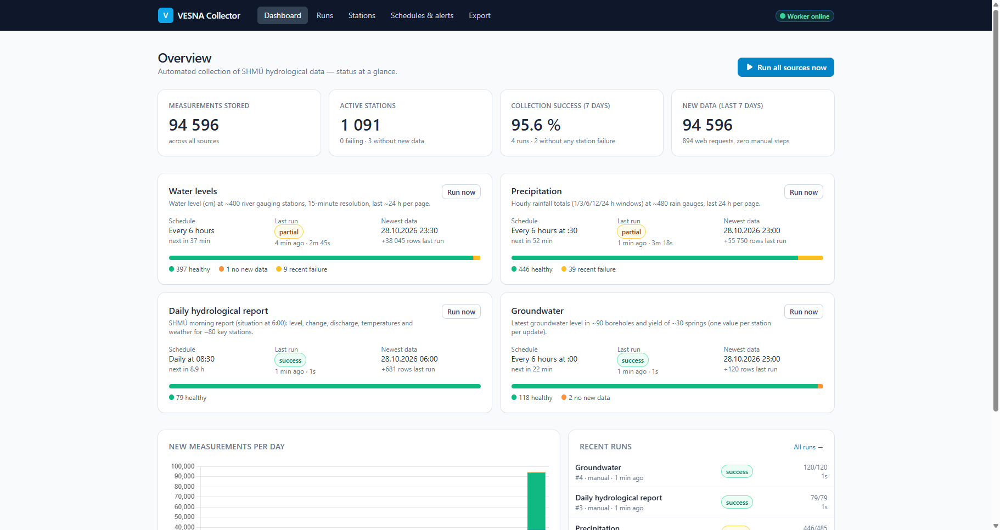
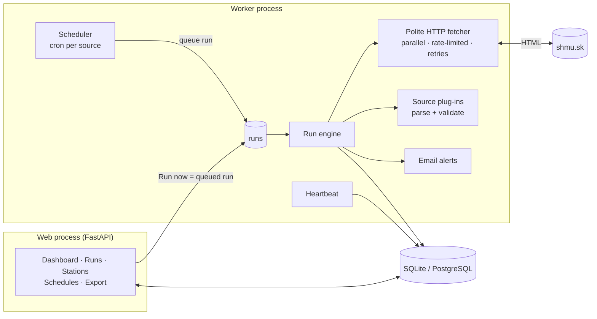

# VESNA Collector

Automated, monitored collection of hydrological data from the Slovak Hydrometeorological
Institute (SHMÚ) — a **proof of concept for process automation**.

It replaces the collection module of VESNA 2.0 with a standalone service that collects data
on a schedule, stores it as a growing time series, shows its own health on a dashboard and
emails someone when something breaks.



---

## The process: before and after

| Step | Before (VESNA 2.0 collection module) | After (VESNA Collector) |
|---|---|---|
| Trigger | One daily time, scheduler thread inside the Apache web process | Independent worker with its own cron schedule per source; manual "Run now" button |
| Execution | Stations fetched one by one with fixed pauses (~33 min for a full run) | Parallel, rate-limited fetching with retries (~6 min for all ~1 100 stations) |
| Storage | One CSV per station, appended without de-duplication | Database time series; each measurement stored exactly once |
| Monitoring | None — failures were silent (e.g. a file-permission error stopped collection for days) | Per-run audit trail, per-station health, worker heartbeat, live progress |
| Error handling | Errors only in server logs | Every failure recorded with station and reason; e-mail alert on failed runs and stations that keep failing |
| Configuration | Edit database rows / files on the server | Web UI: enable/disable stations, edit schedules, see next run times |
| Data access | Download individual CSV files | Charts per station; CSV/Excel export filtered by source and date range |
| Deployment | Manual file uploads, Apache config, file ownership | `docker compose up -d` |

### What is automated

1. **Trigger** — a cron schedule per source (e.g. water levels every 6 h).
2. **Acquisition** — ~1 100 SHMÚ pages fetched politely in parallel; transient errors retried.
3. **Validation** — every page is parsed against the expected structure; layout changes,
   station outages ("Stanica nie je momentálne dostupná") and blocking are detected and
   reported with a clear reason instead of silently producing empty files.
4. **Storage** — new measurements inserted, duplicates ignored, station metadata refreshed,
   new stations discovered automatically (report and groundwater pages).
5. **Monitoring** — run statistics, station health (healthy / recent failure / failing /
   no new data), worker heartbeat.
6. **Escalation** — email when a run fails, when ≥ 20 % of stations fail, or when a station
   fails 3 runs in a row. Humans are involved only when something needs attention.

---

## Data sources

| Source | What | Stations | Default schedule |
|---|---|---|---|
| Water levels | Water level every 15 min (last ~24 h per page) | ~400 | every 6 h |
| Precipitation | Rainfall totals 1/3/6/12/24 h (last 24 h) | ~480 | every 6 h |
| Daily hydrological report | Level, change, discharge, water/air temperature, weather at 6:00 | ~80 | daily 08:30 |
| Groundwater | Borehole groundwater level and spring yield | ~120 | every 6 h |

Because each SHMÚ page only shows the last 24 hours, running at least daily is what turns
SHMÚ's rolling window into a continuous history.

---

## Architecture



* **Web and worker are separate processes.** Restarting or scaling the web app can never kill a
  collection run, and the dashboard shows when the worker is down. They communicate only through the
  database (queued runs, schedules, heartbeat).
* **One run at a time per source.** A run already queued or in progress is never duplicated.
* **Crash recovery.** If the worker stops mid-run, the run is marked as interrupted on restart.

### Project layout

```
collector/
  sources/          one module per data source (+ base interface, parsing helpers)
  seed/             initial station lists
  engine.py         executes a run: fetch → parse → store → update health → alert
  worker.py         scheduler, run queue, heartbeat, cleanup
  http.py           polite concurrent HTTP client
  storage.py        de-duplicated inserts, station health bookkeeping
  notify.py         email alerts
  models.py         database schema
  web/              FastAPI app, Jinja templates (Tailwind, htmx, Chart.js)
tests/              parser tests on saved SHMÚ pages, engine tests with mocked HTTP, web tests
```

---

## Running it

### With Docker (recommended)

Requires [Docker Desktop](https://www.docker.com/products/docker-desktop/).

```bash
cp .env.example .env        # optional: email settings etc.
docker compose up -d --build
```

Open <http://localhost:8000>. On first start the station lists are seeded and the worker
follows the default schedules; click **Run all sources now** to collect immediately.

```bash
docker compose logs -f worker     # watch collection
docker compose restart worker     # after editing .env
docker compose down               # stop (data is kept in the collector-data volume)
```

### Without Docker (development)

```bash
python -m venv .venv
.venv\Scripts\activate            # Windows  (Linux/macOS: source .venv/bin/activate)
pip install -r requirements-dev.txt

python -m collector web           # terminal 1 → http://localhost:8000
python -m collector worker        # terminal 2
```

One-off runs from the command line (no worker needed):

```bash
python -m collector run water_level
python -m collector run all
```

### Tests

```bash
pytest
```

Parser tests use real SHMÚ pages saved in `tests/fixtures/`. If SHMÚ changes its website,
save fresh pages there, fix the parser, and the tests prove the fix.

---

## Configuration

All settings are environment variables (or `.env`); see [.env.example](.env.example).
The most important ones:

| Variable | Default | Meaning |
|---|---|---|
| `HTTP_CONCURRENCY` | 4 | Parallel requests to shmu.sk |
| `HTTP_MIN_DELAY` | 0.4 | Minimum seconds between request starts |
| `FAILING_AFTER` | 3 | Consecutive failures before a station is "failing" and alerted |
| `STALE_DATA_HOURS` | 24 | No newer measurement for this long = "no new data" |
| `SMTP_HOST`, `SMTP_USER`, `SMTP_PASSWORD`, `ALERT_TO` | – | Enable email alerts |
| `DATABASE_URL` | SQLite in `data/` | e.g. `postgresql+psycopg://…` for PostgreSQL (install the driver) |

Schedules and which stations are collected are edited in the web UI.

---

## Adding a data source

1. Create `collector/sources/my_source.py` with a `Source` subclass:
   * `mode = "per_station"` → implement `seed_stations()` and `parse_station_page(html)`, or
   * `mode = "bulk"` → set `bulk_urls` and implement `parse_bulk_page(html, url)`.
2. Register it in `SOURCES` in `collector/sources/__init__.py`.
3. Save an example page to `tests/fixtures/` and add a parser test.

The scheduler, run history, health monitoring, alerts, charts and exports work for it
automatically.

---

## Data model

* `stations` — one row per station and source, with health fields (last success,
  consecutive failures, newest observation).
* `measurements` — `(station, observed_at, variable) → value`, unique, so re-collecting
  overlapping pages never creates duplicates.
* `runs` / `run_events` — audit trail of every run and every problem.
* `source_settings` — schedule per source; `app_state` — worker heartbeat.

Times are local time (Europe/Bratislava), exactly as SHMÚ publishes them.

---

## Notes

* Data © SHMÚ. The collector identifies itself with a descriptive User-Agent and limits its
  request rate; keep `HTTP_CONCURRENCY` / `HTTP_MIN_DELAY` conservative.
* The UI loads Tailwind, htmx and Chart.js from public CDNs, so the browser needs internet access.
* No login is included — run it on a trusted network, or put it behind a reverse proxy with authentication.
